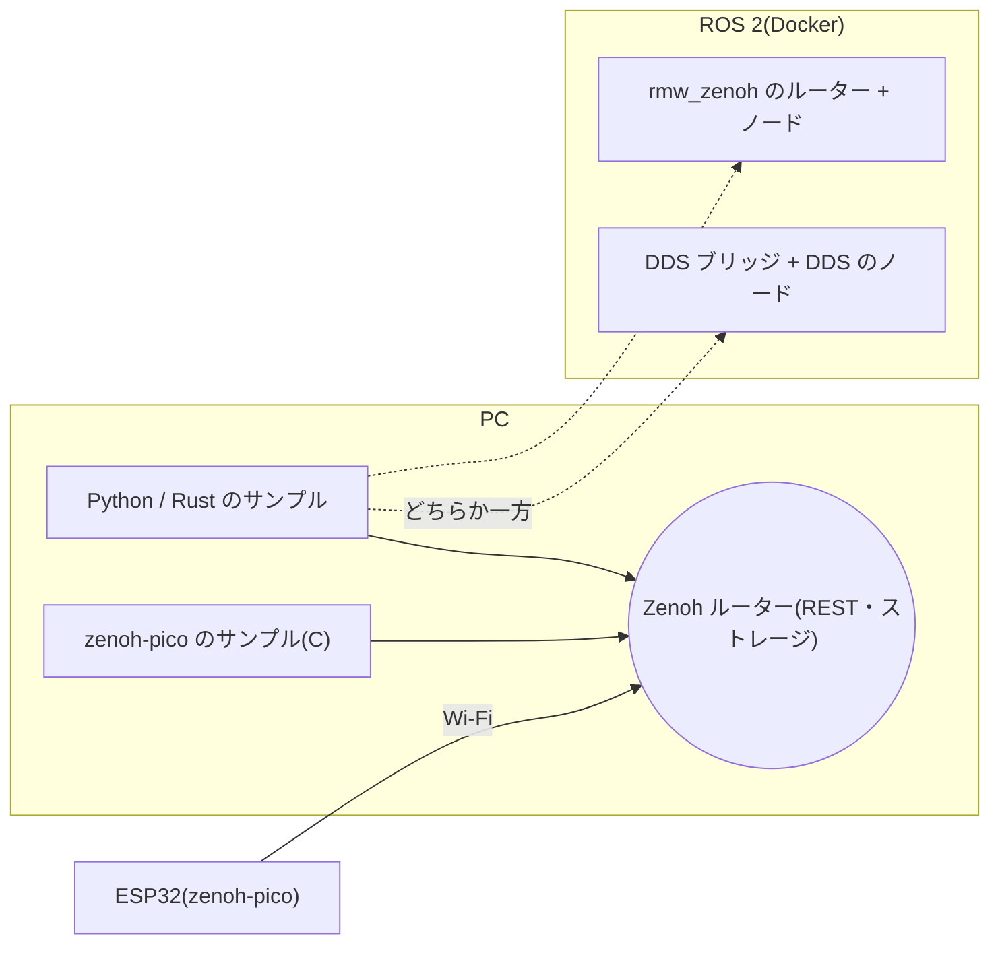

## はじめに

私の周りが皆ROS 2を使っていて、そろそろ違う通信ミドルウェアを使いたいなと思って、Zenohに手を出しました。

Zenoh は、pub/sub と問い合わせ(query)を同じキーの体系で扱える通信ミドルウェアです。ROS 2 の代替ミドルウェアにも選ばれていて、ROS 2 Kilted では Zenoh を使う RMW 実装(rmw_zenoh)が Tier 1 になりました。マイコン向けの C 実装 zenoh-pico もあり、ESP32 のような小さな機器も同じネットワークに参加できます。

ところが調べてみると、日本語で読める情報には、0.x 系の時代のものがまだ多く残っていました。Zenoh は 1.0 で API が大きく変わったので、古い記事のコードはそのままでは動きません。そこで、2026 年 11 月時点で最新の 1.10.2 で一通りの機能を試せるテンプレートを作りました。テンプレートは [kr-work/zenoh-template](https://github.com/kr-work/zenoh-template) に置いておきます。

clone してコマンドを数行打つだけで、次のことを試せます。

- Zenoh ルーターを立てて、pub/sub と問い合わせをする
- ルーターのストレージに保存された最新値を、REST API で取り出す
- Python・Rust・C(zenoh-pico)のプログラムどうしでデータをやり取りする
- ESP32 から Zenoh にデータを送り、PC から LED を操作する(ビルドまで確認済み)
- ROS 2 のトピックを、DDS ブリッジ経由と rmw_zenoh 経由の 2 通りで読み書きする

この記事では、テンプレートで何ができるかを、実際のコマンドと出力でまとめようと思います。Zenoh の仕組みの詳しい説明は、リポジトリの [docs/zenoh-guide.md](https://github.com/kr-work/zenoh-template/blob/main/docs/zenoh-guide.md) に書いています。

なお、記事中の出力は、GitHub から clone したテンプレートで実際に得たものです。動作確認の環境は Windows 11 で、Zenoh ルーターと ROS 2(Jazzy)は Docker で動かしています。zenoh-pico の PC 向けサンプルは Linux のコンテナでビルドしていて、Windows でのビルドは GitHub Actions で通ることを確かめています。ESP32 はビルドまで確認していて、実機ではまだ動かしていないです。

## テンプレートの全体像

テンプレートに入っているものと、つながり方は次のとおりです。



| ディレクトリ | 中身 |
|---|---|
| `docker-compose.yml`、`config/` | Zenoh ルーター(zenohd)と、router・peer・client の設定ファイル |
| `python/` | pub/sub、問い合わせ、ROS 2 連携のスクリプト |
| `rust/` | pub/sub と問い合わせ |
| `pico/desktop/` | zenoh-pico の PC 向けサンプル(CMake) |
| `pico/esp32/` | zenoh-pico の ESP32 向けサンプル(PlatformIO) |
| `ros2/` | DDS ブリッジの構成と、rmw_zenoh の構成(Docker Compose) |

どのサンプルも、pub/sub は `demo/hello/<送信元>`、問い合わせは `demo/info/<送信元>` というキーを使います(送信元は python、rust、pico、esp32)。購読側は `demo/hello/**` を受けるので、言語を混ぜて動かせます。Zenoh のバージョンは、Python・Rust・zenoh-pico・Zenoh の Docker イメージで 1.10.2 にそろえています。rmw_zenoh の構成だけは、ROS 2 のパッケージに含まれる Zenoh を使います。

ルーター・Python・ESP32・ROS 2 を試すのに必要なのは、git と [uv](https://docs.astral.sh/uv/)、Docker だけです。Rust のサンプルには Rust の環境が、zenoh-pico の PC 向けサンプルには CMake と C コンパイラが要ります。

```bash
git clone https://github.com/kr-work/zenoh-template.git
cd zenoh-template/python
uv sync
```

Python のコマンドは `python/` で実行します。ほかの場所で実行するコマンドには、リポジトリのルートからの `cd` を書いています。

## ルーターの起動と pub/sub

まず、Zenoh ルーター(zenohd)を Docker で起動します。

```bash
docker compose up -d
```

別々のターミナルで、購読するスクリプトと送信するスクリプトを動かします。`-m client` はルーターにつなぐモード、`-e` は接続先です。

```bash
uv run sub.py -m client -e tcp/127.0.0.1:7447
```

```bash
uv run pub.py -m client -e tcp/127.0.0.1:7447
```

購読側にデータが届きます。

```text:sub.py の出力
subscribe: 'demo/hello/**'  (Ctrl+C で終了)
<- demo/hello/python [SampleKind.PUT]: [   0] Hello from Python
<- demo/hello/python [SampleKind.PUT]: [   1] Hello from Python
<- demo/hello/python [SampleKind.PUT]: [   2] Hello from Python
```

Zenoh のデータには、`demo/hello/python` のような `/` 区切りのキーが付きます。購読するときは `*`(1 階層)や `**`(0 階層以上)のワイルドカードが使えて、`demo/hello/**` なら `demo/hello` とその下の階層をすべて受け取れます。

スクリプトの中身は、送信側なら次の数行です(`conf` は、設定ファイルやコマンドライン引数から作った `zenoh.Config` です)。

```python:python/pub.py(簡略化)
with zenoh.open(conf) as session:
    pub = session.declare_publisher("demo/hello/python")
    pub.put("Hello from Python", encoding=zenoh.Encoding.TEXT_PLAIN)
```

## 問い合わせ(get / queryable)

Zenoh には pub/sub のほかに、問い合わせて応答をもらう操作があります。応答する側を Queryable と呼びます。

```bash
uv run queryable.py -m client -e tcp/127.0.0.1:7447
```

```bash
uv run get.py -m client -e tcp/127.0.0.1:7447
```

```text:get.py の出力
get: 'demo/info/**'
<- demo/info/python: python queryable, time=2026-11-26T18:25:40
1 件の応答
```

問い合わせ先にもワイルドカードを使えます。既定の設定では、`demo/info/**` に一致する Queryable が複数あれば、それぞれから応答が返ります。設定値の読み出しや、マイコンの状態の取得に向いています。

## ストレージと REST API による最新値の取得

テンプレートのルーターには、REST API と、`demo/hello/**` に流れた値をメモリに保存するストレージを設定してあります。`pub.py` を動かしたあとで HTTP の GET を送ると、キーごとの最新値が返ります。

```bash
curl "http://localhost:8000/demo/hello/**"
```

```json
[{"key":"demo/hello/python","value":"[   1] Hello from Python","encoding":"text/plain","timestamp":"7712408927022114064/eaaf52895c364f5da3821cf8bb93cf5b"}]
```

購読していなかった時間に流れたデータも、ストレージに問い合わせれば最新値が分かります。ブラウザや curl から Zenoh のデータを見られるので、デバッグにも使えます。Windows PowerShell 5.1 では、`curl` の代わりに `curl.exe` と書いてください。

値が文字列のまま返ってくるのは、`pub.py` がエンコーディングを `text/plain` と指定して送っているからです。指定しないで送ったデータは、base64 にした文字列で返ってきます。

## ルーターなしの接続(peer)

Zenoh はルーターがなくても動きます。ルーターを使わずに相手と直接つながるモードを peer と呼びます。次の例では、購読側が 7450 番ポートで待ち受け、送信側がそこに直接つなぎます。

```bash
uv run sub.py -l tcp/127.0.0.1:7450 --no-multicast-scouting
```

```bash
uv run pub.py -e tcp/127.0.0.1:7450 --no-multicast-scouting -n 3
```

同じ LAN の中なら、Zenoh は UDP マルチキャストで相手を自動で見つけるので、接続先を書かなくてもつながります。ただし、Wi-Fi のアクセスポイントが端末どうしの通信を遮断している場合や、Docker Desktop のコンテナとホストの間ではマルチキャストが届きません。そのときは、上のように接続先を指定するか、ルーターを置きます。

アプリのコードは、ルーターを使うときも使わないときも同じで、変わるのは設定だけです。

## Rust と zenoh-pico

Rust のサンプルも同じキーを使うので、Python の購読側でそのまま受け取れます。先ほどの `sub.py` を動かしたまま、別のターミナルで実行します。初回は Zenoh のライブラリのコンパイルに数分かかります。

```bash:リポジトリのルートで
cd rust
cargo run --release --bin pub -- -m client -e tcp/127.0.0.1:7447
```

```text:Python の sub.py の出力
<- demo/hello/rust [SampleKind.PUT]: [   0] Hello from Rust
<- demo/hello/rust [SampleKind.PUT]: [   1] Hello from Rust
```

C で書かれた軽量実装の zenoh-pico も、PC 向けにビルドして試せます。CMake が zenoh-pico 1.10.2 を GitHub から取得して組み込むので、zenoh-pico を別にインストールする必要はありません。

```bash:リポジトリのルートで
cd pico/desktop
cmake -B build
cmake --build build
./build/pico_sub -e tcp/127.0.0.1:7447
```

Windows(Visual Studio)では、実行ファイルは `build\Debug\pico_sub.exe` にできます。この状態で、`python/` で `uv run pub.py -m client -e tcp/127.0.0.1:7447` を実行すると、zenoh-pico の購読側に届きます。

```text:pico_sub の出力
<- demo/hello/python: [   0] Hello from Python
<- demo/hello/python: [   1] Hello from Python
```

zenoh-pico の API は、値の持ち方を型で区別します。関数に貸すだけなら `z_loan(x)`、所有権ごと渡すなら `z_move(x)` を使います。

```c:pico/desktop/src/pico_pub.c(簡略化)
z_owned_bytes_t payload;
z_bytes_copy_from_str(&payload, "Hello from zenoh-pico");
// pub は次の送信でも使うので貸す。payload は送信後に put が解放するので渡す
z_publisher_put(z_loan(pub), z_move(payload), NULL);
```

## ESP32 の接続

ESP32 のサンプルは、Wi-Fi でルーターにつなぎ、`demo/hello/esp32` に状態を JSON で 1 秒ごとに送ります。同時に `demo/esp32/led` を購読していて、`on` を受け取ると LED を点けます。

設定は `esp32dev`(無印の ESP32 の開発ボード)向けです。ESP32-C3・C6・S3 などは `platformio.ini` にボードごとの設定を追加する必要があり、試していないです。特に C6 は、今の設定(PlatformIO の espressif32 6.13.0)の Arduino では対応していません。

最初に、`pico/esp32/include/secrets.example.h` を `secrets.h` にコピーし、Wi-Fi の情報とルーターのアドレスを書きます。

```c:pico/esp32/include/secrets.h
#define WIFI_SSID "your-ssid"
#define WIFI_PASS "your-password"
#define ZENOH_CONNECT "tcp/192.168.1.10:7447"  // ルーターを動かしている PC の IP
```

ビルドは Docker の中で行うので、PC に PlatformIO や CMake を入れる必要はありません。書き込みには esptool を使い、uv が実行時に取得します。

```powershell:Windows(リポジトリのルートで)
cd pico/esp32
powershell -ExecutionPolicy Bypass -File .\build.ps1
powershell -ExecutionPolicy Bypass -File .\flash.ps1 -Port COM5 -Monitor
```

```bash:macOS / Linux(リポジトリのルートで)
cd pico/esp32
bash build.sh
uvx --from esptool==5.7.0 esptool --chip esp32 --port /dev/ttyUSB0 write-flash 0x0 dist/esp32dev/firmware_merged.bin
```

Linux ではシリアルポートは `/dev/ttyUSB0` のような名前、macOS では `/dev/cu.usbserial-...` のような名前になります。なお、macOS と Linux での手順は、Windows で確認した内容からの読み替えで、実際には試していないです。

ビルドすると、RAM は 44,816 バイト(13.7%)、フラッシュは 820,817 バイト(62.6%)を使います。初回はツールチェーンの取得で 2 分ほどかかりますが、2 回目からは 10 秒前後で終わります。

ESP32 は PC の IP アドレスの 7447 番に接続するので、PC のファイアウォールでこのポートへの受信を許可しておく必要があります。

実機では未確認ですが、書き込んだあとは次のコマンドで LED を操作できる作りです。

```bash
uv run pub.py -m client -e tcp/192.168.1.10:7447 -k demo/esp32/led -p on -n 1 --raw
```

ESP32 から送られる状態は、`uv run sub.py -m client -e tcp/192.168.1.10:7447` で見られます。

## ROS 2 との連携

ROS 2 と Zenoh をつなぐ方法は 2 つあり、テンプレートには両方の構成を入れました。

| | DDS ブリッジ(zenoh-bridge-ros2dds) | rmw_zenoh |
|---|---|---|
| ROS 2 のノード | DDS のまま動かす | `RMW_IMPLEMENTATION=rmw_zenoh_cpp` で Zenoh を使う |
| `/chatter` の Zenoh でのキー | `chatter` | `0/chatter/std_msgs::msg::dds_::String_/RIHS01_df66…` |
| 素の Zenoh から読み書きするには | CDR に変換するだけ | 受信はワイルドカードで済む。送信には型ハッシュ入りのキーと添付データが要る |
| 向いている使い方 | ROS 2 の中は今のまま、外とやり取りする部分だけ Zenoh にする | ROS 2 の通信全体を Zenoh にする |

この 2 つはキーの付け方が違うので、互いには通信できません。マイコンや ROS 2 を使わないアプリと混ぜるなら、扱いやすいのはブリッジのほうですかね。どちらの構成も Docker で ROS 2 Jazzy ごと起動するので、PC に ROS 2 が入っていなくても試せます。初回は ROS 2 のイメージの取得とビルドに数分かかります。

ブリッジも rmw_zenoh のルーターも、ここまで使ってきた Zenoh ルーターと同じ 7447 番で待ち受けます。起動する前に、リポジトリのルートで `docker compose down` を実行してルーターを止めてください。ブリッジと rmw_zenoh の構成も、同時には起動できません。

### DDS ブリッジ経由

ブリッジの構成では、DDS で動く talker と listener、`/cmd_vel` を表示するノード、ブリッジが起動します。ROS 2 のトピック名から先頭の `/` を取ったものが Zenoh のキーになり、中身は ROS 2 のメッセージを CDR という形式でバイト列にしたものです。テンプレートのスクリプトが CDR の変換をするので、Python から ROS 2 のトピックを直接読み書きできます。

```bash:リポジトリのルートで
cd ros2/bridge
docker compose up --build
```

ROS 2 のノードのログがこのターミナルに流れ続けるので、Python のスクリプトは別のターミナルで実行します。

```bash:リポジトリのルートで(別のターミナル)
cd python
uv run ros2_bridge.py listen    # ROS 2 の /chatter を受信する
uv run ros2_bridge.py talk      # ROS 2 の /chatter に送る
uv run ros2_bridge.py cmd_vel   # ROS 2 の /cmd_vel に Twist を送る
```

```text:listen の出力
<- chatter: data='Hello World: 12'
<- chatter: data='Hello World: 13'
```

```text:talk を実行したときの listener コンテナのログ(抜粋)
[listener]: I heard: [Hello ROS 2 from Zenoh: 2]
[listener]: I heard: [Hello ROS 2 from Zenoh: 3]
```

zenoh-pico の `pico_cmd_vel` は、Twist を 52 バイトの CDR に詰めて送ります。前の節でビルドしたものを、そのまま使えます。

```bash:リポジトリのルートで
cd pico/desktop
./build/pico_cmd_vel -e tcp/127.0.0.1:7447
```

`ros2 topic echo /cmd_vel` を動かしている `cmd_vel_echo` コンテナに、`linear.x: 0.1`、`angular.z: 0.5` の指令が届きました。確かめたのは PC 向けのビルドですが、zenoh-pico のコードなので、マイコンでも同じ形で送れば ROS 2 のライブラリなしで指令を送れる作りです。ESP32 のサンプルには、Twist の送信は入っていないです。

### rmw_zenoh 経由

rmw_zenoh の構成では、rmw_zenoh 用のルーターと、rmw_zenoh で動く talker と listener が起動します。今回動かした Jazzy の版では、rmw_zenoh は REP 2000 の Tier の表には載っていませんが、apt でバイナリを入れられます。rmw_zenoh のノードは、自分の存在を liveliness トークンという仕組みで Zenoh に知らせています。テンプレートの `graph` コマンドは、このトークンからノードとトピックの一覧を作ります。

```bash:リポジトリのルートで
cd ros2/rmw_zenoh
docker compose up --build
```

```bash:リポジトリのルートで(別のターミナル)
cd python
uv run ros2_rmw_zenoh.py graph
```

```text:graph の出力(抜粋)
/listener
    subscription    /chatter  [std_msgs::msg::dds_::String_]  RIHS01_df668c740482bbd48fb39d76a70dfd4bd59db1288021743503259e948f6b1a18
/talker
    publisher       /chatter  [std_msgs::msg::dds_::String_]  RIHS01_df668c740482bbd48fb39d76a70dfd4bd59db1288021743503259e948f6b1a18
```

`listen` と `talk` で、ROS 2 のノードと素の Zenoh のあいだでメッセージをやり取りできます。`talk` はデータを送るだけで、自分の存在を知らせる liveliness トークンは出さないので、ROS 2 側の `ros2 topic list` には現れません。それでも listener には届きます。

```text:listen の出力
<- data='Hello World: 16'  (seq=16, gid=7dac2481...)
<- data='Hello World: 17'  (seq=17, gid=7dac2481...)
```

```text:talk を実行したときの listener コンテナのログ(抜粋)
[listener]: I heard: [Hello rmw_zenoh from plain Zenoh: 3]
[listener]: I heard: [Hello rmw_zenoh from plain Zenoh: 4]
```

## 作ってみて分かったこと

テンプレートを作る途中で、私もいくつかつまずきました。どれもテンプレート側で対処してあります。

### zenoh-pico 1.7 から不要になった受信タスクの起動

zenoh-pico では、届いたデータを読んでコールバックを呼ぶ処理や、生きていることを定期的に知らせる処理が、裏のタスクで動きます。0.x 系や 1.6 までの 1.x 系では、`zp_start_read_task()` と `zp_start_lease_task()` を自分で呼んで、これらのタスクを起動する必要がありました。公式のサンプルも 1.8 までは呼んでいます。1.7 からは、マルチスレッドでビルドしていれば `z_open` が自動で起動するようになり、1.10.2 ではこれらの関数は非推奨です。古い記事のコードをそのまま使って呼んでも害はありませんが、新しく書くなら要らないです。

### PlatformIO のビルドに必要だった PC 側の CMake と C++ コンパイラ

zenoh-pico を PlatformIO でビルドすると、zenoh-pico のビルドスクリプトが PC 上で cmake を実行して設定ファイルを作ります。しかも Arduino ESP32 向けの設定では C++ も有効になるので、PC に CMake と C/C++ のコンパイラがないと、ESP32 のコードをコンパイルする前に止まります。Windows なら Visual Studio Build Tools のような C/C++ コンパイラまで入れる必要があり、手間がかかるので、テンプレートでは Docker の中でビルドするようにしました。

### Arduino ESP32 で使えない z_loan と z_move

`z_loan` や `z_move` は、C では C11 の `_Generic` を使ったマクロ、C++ では型ごとのオーバーロード関数として用意されています。ESP32 のサンプルは C++ なので本来は使えるはずですが、PlatformIO の Arduino ESP32 向けのビルドでは、zenoh-pico のビルドスクリプトが `ZENOH_C_STANDARD=99` を定義します。zenoh-pico のヘッダーは、この値が 99 のとき、C 向けのマクロも C++ 向けの関数もまとめて無効にするので、コンパイルエラーになりました。ESP32 のサンプルは、`z_session_loan(&s)` や `z_bytes_move(&payload)` のように型ごとの関数で書いています。

### Docker Desktop で使えない COM ポートとマルチキャスト

Windows の Docker Desktop からは、USB シリアル(COM ポート)を直接使えません。そこで、ビルドの最後にブートローダーなどを 1 つのファイルにまとめ、PC 側の esptool でアドレス 0x0 に書き込む形にしました。また、Docker Desktop のコンテナにはマルチキャストが届かないので、ルーターをコンテナで動かすときは、ESP32 側でルーターのアドレスを明示する必要があります。

### rmw_zenoh に送るときの添付データ

rmw_zenoh のトピックに素の Zenoh から送るには、キーに型ハッシュまで入れたうえで、シーケンス番号・送信時刻・送信元の ID を詰めた 33 バイトの添付データを付ける必要がありました。添付データがないと、ROS 2 側はエラーのログを出してメッセージを捨てます。形式は rmw_zenoh の設計資料に書かれていて、テンプレートのスクリプトはそれに従っています。

### Docker の ROS 2 で入れた 2 つの設定

DDS ブリッジは `ROS_DISTRO` 環境変数を見て、Iron より前のディストリビューションかどうかを判断します。ブリッジのイメージ(eclipse/zenoh-bridge-ros2dds)には設定されておらず、iron とみなすという警告が出ました。Jazzy なら iron とみなされても動作は同じですが、Humble では判断が変わるので、compose の設定で `ROS_DISTRO: jazzy` を明示しています。もう 1 つは、rmw_zenoh の README に既知の問題として書かれている件です。rmw_zenoh のルーターは既定で IPv6 のアドレスで待ち受けるので、IPv6 が無効な環境では起動に失敗します。テンプレートでは、IPv4 で待ち受けるように設定を上書きしています。

### CI で空になったログ

GitHub Actions で、購読側の出力をファイルに書き出して確かめるテストが失敗しました。出力をファイルにリダイレクトすると、Python は出力をまとめて溜めてから書き出すので、確認する時点ではファイルが空だったためです。スクリプト側で 1 行ごとに書き出す設定にし、CI の設定でも出力を溜めないようにしました。

## 自分のプロジェクトでの使い方

キーの先頭の `demo/` を、プロジェクトの名前に置き換えます。サンプルのスクリプトのほかに、ルーターの設定(`config/router.json5`)のストレージのキーと、ESP32 の `include/app_config.h` にもキーが書いてあります。キーは `/` 区切りの階層なので、`<プロジェクト>/<装置>/<データの種類>` のように決めておくと、ワイルドカードでまとめて購読できます。

Zenoh のバージョンを上げるときは、README の「バージョンを上げるとき」に並べた箇所をそろえて変えます。GitHub Actions では、Python のテスト、Rust のビルド、zenoh-pico の PC 向けビルド(Linux と Windows)、ESP32 向けのビルドが動くので、上げたあとに壊れていないかを確かめられます。

Zenoh の仕組み(キー式、3 つのモード、ブリッジと rmw_zenoh の違いなど)が気になった方は、リポジトリの [docs/zenoh-guide.md](https://github.com/kr-work/zenoh-template/blob/main/docs/zenoh-guide.md) を参照してください。

## 参考資料

- [Zenoh 公式サイト](https://zenoh.io/)
- [eclipse-zenoh/zenoh](https://github.com/eclipse-zenoh/zenoh)、[zenoh-pico](https://github.com/eclipse-zenoh/zenoh-pico)、[zenoh-python](https://github.com/eclipse-zenoh/zenoh-python)
- [eclipse-zenoh/zenoh-plugin-ros2dds](https://github.com/eclipse-zenoh/zenoh-plugin-ros2dds)(DDS ブリッジ)
- [ros2/rmw_zenoh](https://github.com/ros2/rmw_zenoh) と [設計資料](https://github.com/ros2/rmw_zenoh/blob/rolling/docs/design.md)
- [REP 2000: ROS 2 Releases and Target Platforms](https://www.ros.org/reps/rep-2000.html)
- [Zenoh 1.10.x: Mucalinda](https://zenoh.io/blog/2026-08-17-zenoh-1.10/)

日本語の関連記事:

- [Zenoh概要紹介](https://qiita.com/c-metscher/items/54b4a2851af070c649ea)(DDS の課題と rmw_zenoh の背景)
- [rmw_zenohでNAT越え通信する](https://qiita.com/MrBearing/items/1fe7af98acbe2144b755)(ルーターを使った拠点間の接続)
- [Zenoh-picoでシリアル経由でPub/Subしたい](https://zenn.dev/fate_shelled/scraps/31fca73cc4c191)(ESP32 と PC を UART でつなぐ例。0.10 系の時代の記録)
